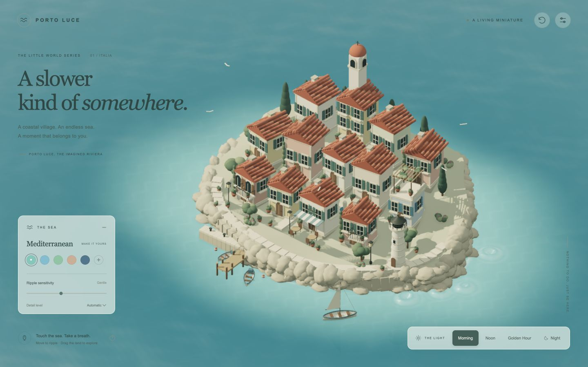

# Porto Luce

브라우저에서 감상하고 만질 수 있는 지중해 해안 마을. Vite, TypeScript, Three.js로 구현한 실제 3D 디오라마입니다. 건물·지형·소품·텍스처는 프로젝트에서 절차적으로 생성하며 실행 중 외부 에셋이나 폰트 서버를 사용하지 않습니다.



## 실행

Node.js 20.19+ 또는 22.12+가 필요합니다.

```sh
npm ci
npm run dev
```

기본 주소는 `http://localhost:5173`입니다.

```sh
npm run build
npm run preview
```

`dist/`를 정적 웹 호스팅에 배포할 수 있습니다. 별도 서버, API 키, 계정이 필요하지 않습니다.

## 조작

| 입력 | 동작 |
| --- | --- |
| 바다 위 커서 이동 | 이동 속도에 따른 작은 잔물결 |
| 바다 왼쪽 클릭 / 드래그 | 강한 파동 / 경로를 따라 물 휘젓기 |
| 육지 왼쪽 드래그 | 관성이 있는 시점 회전 |
| 오른쪽 또는 Shift 드래그 | 위치에 관계없이 시점 회전 |
| 휠 | 확대·축소 |
| 한 손가락 | 바다 상호작용, 육지 시점 회전 |
| 두 손가락 | 시점 회전·핀치 확대 |
| 등대 / 보트 클릭 | 등대 켜기·끄기 / 보트의 느린 이동 전환 |
| 상단 초기화 버튼 / R | 기본 카메라 구도 복원 |

상단 설정 버튼으로 패널을 접고 펼칩니다. 모바일에서는 장면을 먼저 보여주기 위해 패널을 접습니다. 도움말 버튼에서 조작법을 확인할 수 있습니다.

## 구현

- 불규칙한 해안선과 연속적인 고도, 풍화된 석회암 절벽, 돌길·계단·항구
- 13채의 서로 다른 주택, 종탑, 등대, 입체 기와, 아치형 문·창, 셔터, 난간·발코니, 카페, 옥상 퍼골라
- 화분·꽃·덩굴·나무·빨랫줄·가로등·밧줄·부표·곡면 보트·날아다니는 갈매기
- 여러 파장과 방향의 수면 변위, 해안 거리 기반 얕은/깊은 색, Fresnel, 노멀 변화, 실제 장면의 평면 반사, 포말
- 24개의 고정 파동 버퍼: 클릭·드래그·커서 파동을 GLSL에서 중첩하고 확산·감쇠
- 화면 레이를 실제 파동 높이장과 반복적으로 교차시켜 수면 입력 좌표 계산; 육지·보트 가림 판정
- 5개 바다 프리셋과 직접 색상 선택, 4개 시간대의 실제 광원 위치·세기·색·환경광 전환
- 부드러운 설정 전환, 야간 창문·가로등, 클릭으로 제어하는 등대와 보트
- 재질별 정적 지오메트리 병합, DPR 제한, 주변부보다 촘촘한 수면 지오메트리, 주기적 반사 갱신
- High 모드의 GTAO 접촉 음영, 모바일 자동 Balanced 모드

## 코드 구성

```text
src/
  main.ts                  초기화, 프레임 루프, 품질·화면 크기 관리
  interaction.ts           레이캐스팅, 수면 입력, 카메라, 터치
  ui.ts / style.css        설정 패널과 반응형 UI
  world/
    terrain.ts             해안 지형, 절벽, 길
    village.ts             건축, 식생, 생활 소품, 보트와 등대
    geometry.ts            모델링 도구, 정적 배칭
    materials.ts           로컬 텍스처와 PBR 재질
    water.ts               GLSL 수면, 파동, 색상, 반사
    lighting.ts            시간대별 실제 조명
    postprocessing.ts      GTAO와 출력 변환
```

## 검증과 한계

검증 기록은 `QA.md`를 확인하세요. WebGL2와 하드웨어 가속이 필요합니다. 수심 색상은 해안선까지의 거리를 이용한 근사이며, 수면은 유체역학 솔버 대신 해석적인 파동을 사용합니다. 반사는 성능을 위해 3–5프레임마다 갱신합니다. 건물 내부는 모델링하지 않았습니다.

60FPS는 장치·해상도에 따라 달라집니다. 모바일 레이아웃은 브라우저 뷰포트에서 확인했으며, 실제 iOS/Android 기기의 멀티터치·GPU 성능은 별도 확인이 필요합니다. 수 시간 단위의 메모리 안정성 검증은 수행하지 않았습니다.

외부 미술 에셋을 사용하지 않았습니다. npm 의존성의 라이선스는 각 패키지에 포함되어 있습니다.
