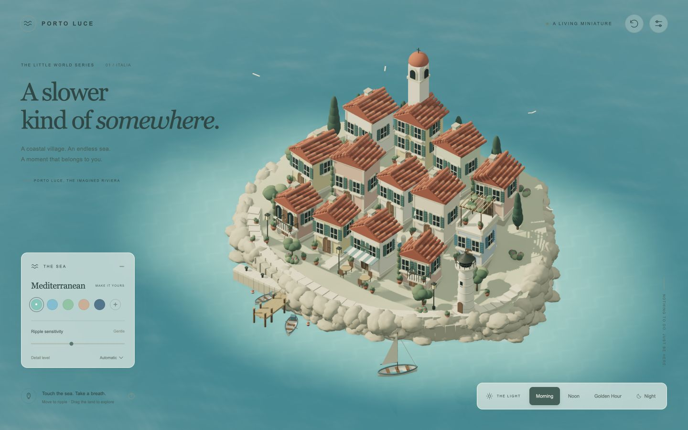
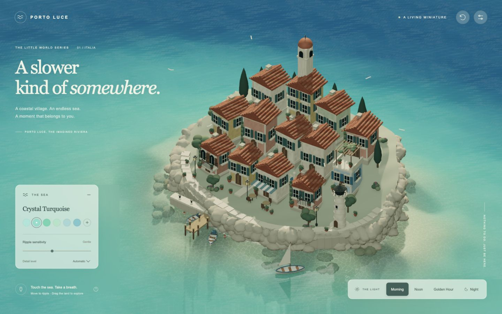
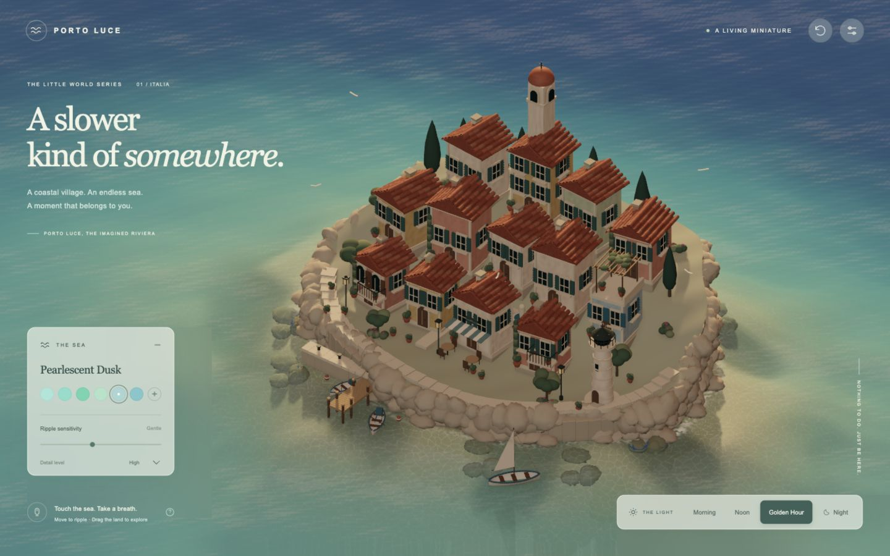
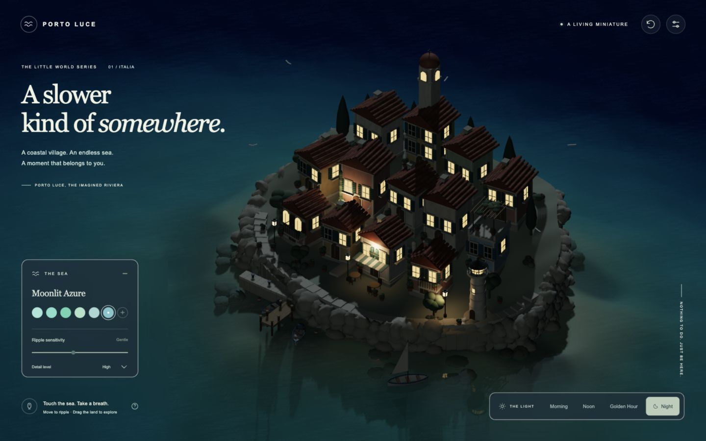
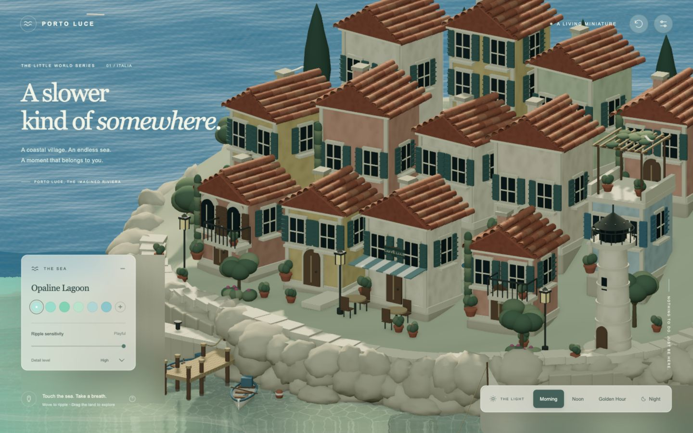
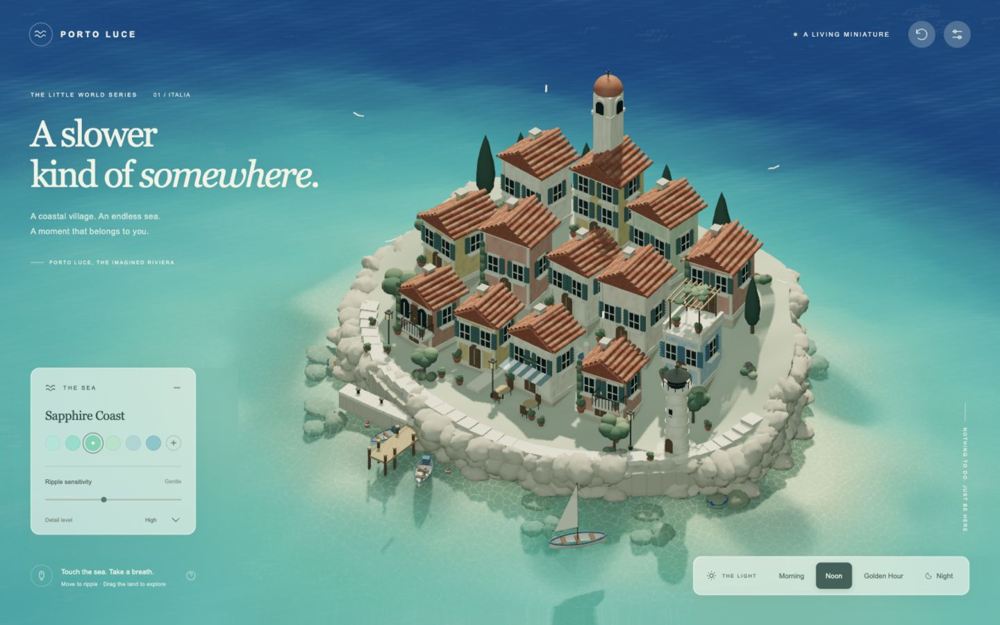
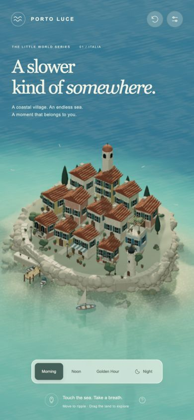

# 실제 렌더링 비교

동일한 초기 카메라(yaw 0.640, zoom 1.000), 1440×900, Morning에서 비교했습니다. 기존 Mediterranean 이름은 새 Crystal Turquoise 광학 프로파일로 연결됩니다. 시간대의 이름과 카메라는 유지하고 조명·재질·바다를 리마스터했습니다.

| 개선 전 | 개선 후 |
| --- | --- |
|  |  |

| Opaline Lagoon / Morning | Sapphire Coast / Noon |
| --- | --- |
|  |  |

| Pearlescent Dusk / Golden Hour | Moonlit Azure / Night |
| --- | --- |
|  |  |

가까운 시점의 건축·해안 재질, 수면 입력과 모바일 구도:

